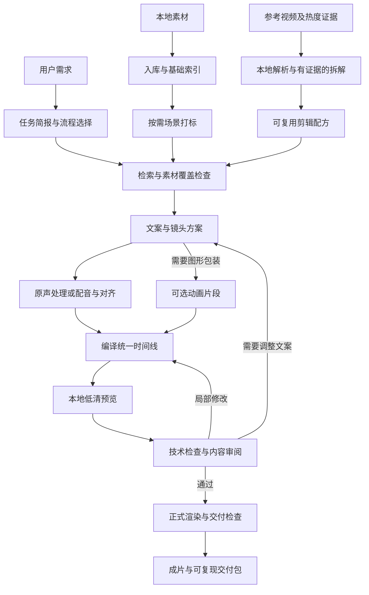

# ClipForge Skills 架构草案

状态：2026-10-08总体调研设计。2026-10-09最小执行基线已按[ADR-003](ADR/003-portable-skill-migration.md)实施，当前契约以API/Schema为准，实际状态见[开发计划](DEVELOPMENT_PLAN.md)。下文中更完整的模型与动画能力仍属后续设计。

2026-10-09业务需求补充：见[示例品牌运营目标与开发指导](BUSINESS_CONTENT_GUIDE.md)及[ADR-002](ADR/002-business-content-contracts.md)。新增产品事实、活动有效期、审核版本和门店内容交付的设计要求，当前范围仍止于成片交付。

本轮用户确认的业务边界：**热门视频拆解 → 本地素材库 → 场景打标 → 文案与镜头策划 → 剪辑制作 → 检查与成片交付**。发布、排期、运营数据回填与效果复盘留作后续扩展。

本文保留原始源码调研与总体设计。截至2026-10-10，已完成本地技术样例、真实素材入库和六场景内部审阅片；完整视听审阅、正式业务交付、识别模型与质量收益验收仍未完成。不得将下述目标能力全部视为当前可用，具体证据见开发计划。

2026-10-09深入修订：提示词、调度、审核和恢复的源码核对见[Harness研究](HARNESS_RESEARCH.md)，当前提示词落实与coverage契约见ADR-004。目录与流程划分不作为创作效果的证明。

2026-10-09结果导向实施：9个Skills按观众目标、画面/声音证据、关键段预览和最小修复工作；H2以独立creative-state Schema及creative-save/context保存版本化创作依据、工件哈希、锁定与问题。EditPlan v1和生产交付契约不变；H3/H4未实现的机器门禁不能由创作记录代替。详见ADR-006和开发计划最新总览。

## 1. 调研小结

### 1.1 现有项目与目标的关系

ClipForge 已有可复用的本地执行基础：`vidtag` 负责分镜与多层标注，`assethub` 管理素材索引，`vidmake` 提供脚本、选片、音频、合成与检查流程，`mediaops` 承载运营系统。当前仓库已包含 CLI 包装型 skills；本次改造的重点是改变编排、数据契约与复用方式，而非只增加 SKILL.md。

现有 `fvm make --force-rule` 已能跳过其内部 LLM 分镜，应该保留并作为模板模式的基础；不必为了迁移到 skills 而把本地规则改成模型调用。

推荐形态：**一个业务入口 skill + 按需加载的业务子 skills + 本地 CLI 工具包 + 持久化素材与作品文件**。Codex / Claude Code 承担交互和需要语义判断的工作，本地工具完成机械处理。这里的“子 skill”是按需读取的能力说明，并不自动等于子 agent、独立模型会话或后台服务。

### 1.2 五个参考项目的取舍

| 项目 | 已核对的结构与代码 | 推荐借鉴 | 本次取舍 |
|---|---|---|---|
| [Hypit][hypit] | skill 分层引用、Timeline、build 输出复用、本地 scheduler | 把作品保存为可再执行的方案；语义锚点定位；复用已成功的中间产物 | 暂不引入整套专用语言与生成媒体运行时；按需补充生成能力 |
| [OpenMontage][openmontage] | pipeline YAML、阶段 skill、tool registry、成本台账 | 流程配方、工具能力发现、阶段输入输出、预算与失败恢复 | 批量机械步骤合并为本地执行；不照搬每阶段模型往返与审批 |
| [DramaClaw][dramaclaw] | typed skill inputs/outputs、idempotency_key、AssetResolver | 类型明确的任务契约、素材身份与引用关系、可重试错误 | 其内部 skill 节点不是通用 SKILL.md；不引入画布、账号与服务端架构 |
| [huashu-art-motion][huashu] | 按任务加载参考、静帧到动效、参考片分析脚本、动画 QA | 风格配方、先静帧再短段验证、按需生成包装动画 | 图形动画作为可选生产环节；动画运动量指标不用于判定口播片好坏 |
| [Hyperframes][hyperframes] | HTML 可定位时间渲染、Puppeteer + FFmpeg、确定性约束 | 可复现的字幕、图表、产品参数与讲解动画 | 普通素材剪辑优先 FFmpeg；需要代码动画时接入，锁定验证过的版本 |

参考项目之间也存在不能直接照搬的判断。例如 OpenMontage 的 reference analyst 将大量 `motion_clip` 推向视频生成，但“画面有运动”不能证明来源是 AI 生成；本项目必须分别记录可观察运动与未知制作来源。其 documentary-montage 配方还明确声明 `reference_input.supported: false`，不能由 README 的全局描述推断所有配方都支持参考片。

huashu 的参考片分析脚本使用完整解码数组进行若干分析，迁移到长视频与素材库批处理时应改为限分辨率、分窗口或流式计算，并复用代理文件。这是源码层面的容量风险判断，尚无本机性能测试。

上述项目的许可证条件并不一致。当前仅借鉴设计；若后续复制、修改或分发源代码，应按所选提交逐项核对 LICENSE 与依赖条件。

### 1.3 skills 的宿主边界

[Agent Skills 规范][agent-skills]、[Codex skills 文档][codex-skills]与[Claude Code skills 文档][claude-skills]支持以 SKILL.md 与按需引用资源组织能力。共享业务说明、脚本与数据契约；宿主安装位置及特有配置通过薄适配层处理。

不假设两个宿主会自动以相同方式调用嵌套 skill，也不把 Claude 专有的执行选项当作通用协议。入口明确列出路由规则、应读取的子 skill 路径、工具调用和产物要求。

## 2. 工作方式：数据驱动，CLI 优先

参考片不是所有任务的前置条件；已有配方可以直接复用。素材入库和基础索引也可独立完成。每次制作只执行缺失或失效的阶段。

2026-10-10明确制作入口为“本次素材批次＋制作提示词”：宿主从提示词整理目标、主推品及相关价格，默认只在选定文件对应的asset_id范围选片；检查动作与镜头连贯性，仅对必要缺失或实际冲突追问。共享索引不等于允许跨批次选片。当前由Skill指导宿主执行范围核对，CLI尚无批次过滤或强制校验；本次未变更数据契约。

### 2.1 热门视频拆解

本地提取元数据、分镜、关键帧、字幕或转写、音频与可计算的节奏特征；模型按问题读取限量的时序帧组和文本。

输出分为三类：

- **观察事实**：带时间码的钩子、信息展开、画面变化、字幕位置、声音与切点关系，关联帧或转写证据。
- **编辑解释**：为何这种结构可能有效、适用什么受众，明确是解释或假设。
- **复用配方**：各段功能、节奏范围、素材要求、字幕与音频规则、允许变化项，供新作品使用。

“热门”需要平台、来源链接、采集时间和可获得的热度数据；数据缺失时只称参考视频。画面分析不能证明传播效果的因果关系。拆解配方与可用于成片的素材分开管理，参考视频不自动成为可用素材。

### 2.2 本地素材库

以素材内容哈希识别文件，以稳定 asset_id 引用内容；存放根目录通过映射解析，避免工程永久依赖某一台机器的绝对路径。保留源文件，分镜默认记录时间区间，不提前复制每个切片。

保存原始来源、授权备注、技术信息、镜头区间、代理文件、帧图、转写和标注。便携清单与分析产物可导出；SQLite/FTS 作为可重建的本地查询索引。向量检索在有实测收益后增加，不作为最小闭环前置依赖。

批量入库一次提交本地任务；工具只向模型返回摘要、错误和产物路径。检索先按技术与业务条件筛选，再返回有限候选，避免将整库标签塞入上下文。

### 2.3 场景打标

| 层次 | 内容 | 执行策略 |
|---|---|---|
| 基础属性 | 时长、尺寸、镜头、音频、清晰度、转写/OCR等 | 确定性分析优先；较重处理按需求启用 |
| 观察标签 | 对象、动作、画面文字、场景、构图 | 复用现有本地模型；复杂片段才补充视觉语义判断 |
| 业务标签 | 商品细节、操作步骤、菜品、知识点、问题/回答等 | 由场景 profile 定义，仅计算本次需要的字段 |
| 编辑用途 | 可作开场、证据、过渡、补充画面、收尾等 | 结合本次任务判断，避免把用途固化为素材永久事实 |

每个标注至少带素材与时间区间、标签定义版本、来源类型、证据引用、生产工具/模型版本、审核状态。置信度允许为空；未校准模型给出的分数不能包装成真实概率。未分析、未观察到与不适用须区分。

profile 建议包含标签定义、本地特征映射、语义判断指南、检索规则和场景验收样例。新增场景主要增加 profile 与配方，共用已有底层特征。比如“宠物进食”可由时序观察支持，而“长期改善健康”需要额外事实来源，不能从一个进食镜头推断。

### 2.4 文案与剪辑

先核对事实和素材覆盖，再完成文案及镜头方案。每段文案对应事实来源、候选镜头或明确的图形表达；发现缺口时调整表达、检索补料或请求必要素材，不生成看似真实的证明画面填空。

营销素材混剪、口播切片、知识讲解可以共享能力，但使用不同配方：前者强调商品与镜头覆盖，口播强调语义完整与原声连续，讲解可增加概念图与参数动画。

真实音频生成或原声剪裁完成后，再确定字幕与画面的最终时间。文案阶段使用段落/词语锚点；执行阶段编译为唯一帧时间线。源素材时间与成片时间分开记录，变速、转场及可变帧率处理需要明确映射。

先产低清预览，允许“替换开头两秒”“保留口播，换补充画面”“只改字幕颜色”等局部修改。新的方案版本保存差异与失效节点，复用未变化的索引、转写、标签、配音或动画。

### 2.5 成片检查与交付

技术检查覆盖实际文件存在且可解码、画面规格、时间范围、音画对齐、字幕越界、音频峰值与响度等；内容检查覆盖文案事实、素材匹配、主体裁切、节奏和重复镜头。可执行检查与人工/模型审阅分别记录。

按场景启用检查：静态讲解不因运动少直接失败；短动画需检查起止与中间状态。没有实际听取音频或查看画面的项目，必须标记未审阅，不由元数据替代质量结论。

候选基础交付包为成片、字幕、剪辑方案、依赖与版本清单、检查报告。用户是否需要剪映或其他编辑器工程仍待确认；可复现 JSON 方案不等同于已适配某编辑器的工程。

## 3. skill、配方与工具的职责

下列是能力划分草案，不要求第一版同时实现全部九个子 skill。低频能力先作为引用文档，确有独立触发需求后再独立成 skill。

| 能力入口 | 负责的判断与结果 | 本地工具职责 |
|---|---|---|
| clipforge | 需求简报、范围、流程路由、状态与恢复 | 能力探测、阶段状态、任务日志 |
| clipforge-reference | 拆解参考视频，形成有证据的配方 | 探测、分镜、帧组、转写与特征 |
| clipforge-library | 入库管理、素材查询、候选集 | 哈希、索引、去重、代理和批处理 |
| clipforge-tag | 场景标签选择与不确定片段审阅 | 本地识别、缓存、批量标签写入 |
| clipforge-story | 事实核对、文案、段落与镜头方案 | 检索、覆盖检查、方案校验 |
| clipforge-edit | 镜头编排、局部修订、剪辑意图 | 时间线编译、合成和修订应用 |
| clipforge-audio | 原声/配音、字幕与音乐的选用 | ASR、TTS、对齐、混音与字幕生成 |
| clipforge-motion | 必要的讲解动画、图形与包装 | 确定性 HTML 动画渲染及片段输出 |
| clipforge-review | 技术检查汇总、内容审阅与反馈 | 媒体检测、抽帧、检查报告 |
| clipforge-deliver | 规格选择、依赖完整性和交付清单 | 最终编码、打包、工程导出适配 |

skill 说明“何时用、如何决策、读哪些产物、何时结束”；workflow recipe 声明阶段依赖与检查点；profile 定义场景标签和编辑规则；tool 执行确定的输入输出。工具不是每个都包装成独立 skill。

只在实际有多种实现的位置设置 Provider，例如普通 FFmpeg 合成与 Hyperframes 动画渲染、已配置的 ASR/TTS。以能力检测判断可用性，不假设安装了工具就具备相同效果。

## 4. 契约与持久化草案

所有产物带 schema_version、artifact_id、revision、producer 与 upstream_refs。以下为待冻结的契约边界，不是已实现 API。

| 产物 | 最小核心字段 | 主要消费者 |
|---|---|---|
| Brief | 目标、受众、场景、时长/比例、素材范围、交付规格、成本模式、约束 | 路由、文案、审阅 |
| ReferenceRecipe | 来源及热度证据、时间段观察、解释、结构配方、素材要求 | 文案、剪辑 |
| Asset/Analysis | asset_id、哈希、位置映射、镜头范围、特征与标注证据、版本 | 素材检索、审阅 |
| StoryPlan | 文案段、事实来源、语义锚点、候选素材、覆盖缺口、锁定项 | 音频、时间线编译 |
| EditPlan | 画布/帧率、源片段范围、轨道、变速/转场、字幕与声音、输出规格 | 确定性渲染 |
| RunLedger | trace_id、阶段状态、输入指纹、工具版本、时耗、成本、重试/幂等信息 | 恢复、预算、诊断 |
| Review/Delivery | 检查项目与证据、未审项、输出文件校验、编辑器兼容范围 | 交付 |

目录建议：`skills/` 保存便携技能；`profiles/` 保存场景规则；`recipes/` 保存工作流；`schemas/` 保存契约；`tools/` 保存可执行工具；`docs/` 维护架构、技术栈、API 与 ADR。媒体与分析缓存放在用户指定的数据根目录，项目输出独立存放，避免混入源码仓库。

CLI 成功响应提供 status、artifact_refs、简短 summary；失败提供 error_code、retryable 和诊断引用。长日志保留本地，通过 trace_id 查询。stdout 保持机器可读，进度送往 stderr。不要用超长日志代替产物。

幂等键防止重复提交；缓存键包括内容哈希、处理区间、预处理参数、工具/模型/标签/提示模板版本及相关配置。重启时验证产物完整性与依赖指纹，不能只判断文件存在。远程请求超时先查任务或费用状态，再决定是否重试。

## 5. 成本策略

| 模式 | 使用方式 | 适合任务 |
|---|---|---|
| 模板优先 | 复用配方与已标素材，本地检索/排序/渲染；只做必要交互 | 重复营销混剪、批量多版本 |
| 标准 | 本地基础分析，模型只看候选与困难片段 | 新参考片、跨素材文案与镜头策划 |
| 增强 | 对明确缺口启用额外视觉推理、动画或生成服务 | 复杂解释、特殊风格或新内容 |

模板优先仍会有宿主交互 token，不能声称零 token。skill 也不能承诺硬限制宿主自身的订阅/token 计费。可以约束输入摘要长度、帧数、候选数、修订次数与外部 API 请求；宿主可提供使用数据时记实值，否则记未知。

控制成本的顺序：先复用已有分析与配方；再用本地规则缩小候选；只对必要证据调用模型；再将纯机械批处理合并执行。每个镜头一轮模型对话、每个阶段启动一个 agent，均不作为默认流程。

外部 API 独立记录估算、额度预留与实际结算；本地 CPU/GPU 时间、峰值内存、磁盘占用单独记录。没有基准实测前不宣称节省比例。Hyperframes 动画渲染应先验证静帧与短片段，普通剪辑不默认经过浏览器逐帧渲染。

## 6. 对现有 ClipForge 的变更影响

| 影响面 | 现状证据与问题 | 建议处理 |
|---|---|---|
| vidtag | taxonomy 存在宠物食品相关语义 | 保留现有 profile，基础标签与场景标签分层，不直接覆盖历史标注 |
| assethub | 已有本地素材索引 | 增加适配读取与稳定 ID/证据字段，先验证旧库迁移与可重建性 |
| vidmake 决策流程 | `script_stage` 会再次执行语义绑定与选片 | 增加已审定 StoryPlan/EditPlan 的直接导入路径，避免宿主计划被隐式重算 |
| 自动降级 | skill 文档与默认 `allow_rule_fallback: false` 存在差异 | 明确模板路径与语义路径，能力缺失时返回实际状态 |
| 素材检索 | 部分空检索路径会进入 fixture 数据 | 将示例运行与真实交付模式显式分离；真实模式不得静默使用演示素材 |
| 成功判断 | run 的 ok 与 qa_ok 分离；make 已有默认严格 QA 门槛；媒体 QA 的状态检查接受 skipped/no_media | 保留已有严格检查并统一交付语义；delivered 必须有可解码成片与明确检查结果 |
| 渲染 | 已有可选 Hyperframes provider；配置中存在 latest 引用 | 延续现有能力，固定通过验证的引擎、浏览器与字体等版本 |
| 编辑器交付 | 剪映导出文档声明非官方格式、绝对路径等限制 | 作为独立适配验收，不能等同 MP4 导出已完成 |
| mediaops | 含发布与运营系统 | 保留原系统，当前 skill 制作主线不依赖它；以后通过交付产物扩展 |

迁移顺序：读取旧产物 → 建立新契约适配 → 跑通既有营销样片 → 验证与旧行为的差异 → 再扩场景。方案不得移动原素材、覆盖旧库或改变既有服务部署。接口变更在实施前记录 ADR、更新 API 参考，并按影响范围回归。

## 7. 分阶段证明与待确认事项

1. **冻结设计与环境组合**：确认首批新增场景、交付格式、常用素材规模与硬件。环境准备前执行用户要求的 `agent env-check`；若该命令不可用，报告缺口并确认替代检查。随后将实际验证的版本、驱动模式与 Provider 取舍写入 STACK，工具写入 TOOLS；当前本机初始化及验证结果见STACK和DEVELOPMENT_PLAN。
2. **最小完整闭环**：一条参考短视频、一组真实本地素材，完成拆解、入库、必要标签、文案、约 20–30 秒样片、检查与交付包。时长是验收建议，待样例选择后确定。记录首跑与重复运行成本。
3. **验证低成本修改与扩场景**：改字幕颜色不重跑打标/配音；替换开头只失效相关产物；新增一个 profile 复用基础索引。增加原声切片等场景时独立验收语义完整性。
4. **补齐可选包装和工程导出**：按实际需求接入动画与编辑器。随后分别在 Codex 与 Claude Code 验证安装、路由、恢复和交付。

每阶段验收同时记录功能结果与证据：实际成片、方案、日志、检查报告、可重复操作。成本比较使用相同素材与任务，分冷启动、缓存复用和局部修订；标注质量使用经核对的场景样例，检索质量以候选相关性验证。不得用文件数、代码量或测试数表示业务完成度。

两个宿主应能读写同一契约并完成相同业务，不要求文案逐字一致。跨平台编码也不预设输出字节完全一致；确定性验证应限定工具链、字体、随机种子与媒体依赖。

用户已确认首期交付MP4、字幕和可复现方案，编辑器工程后续适配；真实素材将后续放入指定目录。素材规模、业务事实和额外模型预算仍未确认，当前工具不额外调用付费模型。

## 8. 可追溯源码与文档

ClipForge 核对提交：`77a7e73e1f898581d325f3070b574ea0894d8a76`。重点代码：[脚本阶段][cf-script]、[编排][cf-orch]、[QA][cf-qa]、[默认配置][cf-config]、[时间线契约][cf-plan]、[渲染 Provider][cf-providers]、[编辑器导出][cf-export]。

参考项目按下列提交固定证据，避免后续默认分支变化影响判断：

| 项目 | 提交 | 主要核对文件 |
|---|---|---|
| Hypit | 7f730abf72fa1e4a543eed8cd1807319d9f18196 | skills/hypit/SKILL.md、packages/timeline/README.md、references/production/builds.md |
| OpenMontage | 9327439db69021ab4b0e2776729bf3b58fdb5a87 | docs/ARCHITECTURE.md、tools/tool_registry.py、tools/cost_tracker.py、pipeline_defs |
| DramaClaw | 9822d6fd9ff6d9d2d47d725209b88af75140f676 | freezone/skill_registry.py、utils/asset_resolver.py、docs/en/concepts/architecture.md |
| huashu-art-motion | 57d67608ab458f57d9b153b1a2831b921e22498b | SKILL.md、scripts/analyze/breakdown.py、scripts/qa.py |
| Hyperframes | 188475aaf2cc94d05a5a641341cab3020c131f16 | skills/hyperframes/SKILL.md、packages/engine/README.md、determinism-rules.md |

[hypit]: https://github.com/hypit-ai/hypit/tree/7f730abf72fa1e4a543eed8cd1807319d9f18196
[openmontage]: https://github.com/calesthio/OpenMontage/blob/9327439db69021ab4b0e2776729bf3b58fdb5a87/docs/ARCHITECTURE.md
[dramaclaw]: https://github.com/dramaclaw/dramaclaw/blob/9822d6fd9ff6d9d2d47d725209b88af75140f676/src/novelvideo/freezone/skill_registry.py
[huashu]: https://github.com/alchaincyf/huashu-art-motion/blob/57d67608ab458f57d9b153b1a2831b921e22498b/SKILL.md
[hyperframes]: https://github.com/heygen-com/hyperframes/blob/188475aaf2cc94d05a5a641341cab3020c131f16/packages/engine/README.md
[agent-skills]: https://agentskills.io/specification
[codex-skills]: https://developers.openai.com/codex/skills
[claude-skills]: https://code.claude.com/docs/en/skills
[cf-script]: https://github.com/fantiny/clipforge/blob/77a7e73e1f898581d325f3070b574ea0894d8a76/vidmake/src/feedcut_script/__init__.py
[cf-orch]: https://github.com/fantiny/clipforge/blob/77a7e73e1f898581d325f3070b574ea0894d8a76/vidmake/src/feedcut_orch/__init__.py
[cf-qa]: https://github.com/fantiny/clipforge/blob/77a7e73e1f898581d325f3070b574ea0894d8a76/vidmake/src/feedcut_qa/__init__.py
[cf-config]: https://github.com/fantiny/clipforge/blob/77a7e73e1f898581d325f3070b574ea0894d8a76/vidmake/config/default.yaml
[cf-plan]: https://github.com/fantiny/clipforge/blob/77a7e73e1f898581d325f3070b574ea0894d8a76/vidmake/schemas/edit_plan.schema.json
[cf-providers]: https://github.com/fantiny/clipforge/blob/77a7e73e1f898581d325f3070b574ea0894d8a76/vidmake/config/providers.yaml
[cf-export]: https://github.com/fantiny/clipforge/blob/77a7e73e1f898581d325f3070b574ea0894d8a76/vidmake/src/feedcut_export/__init__.py
